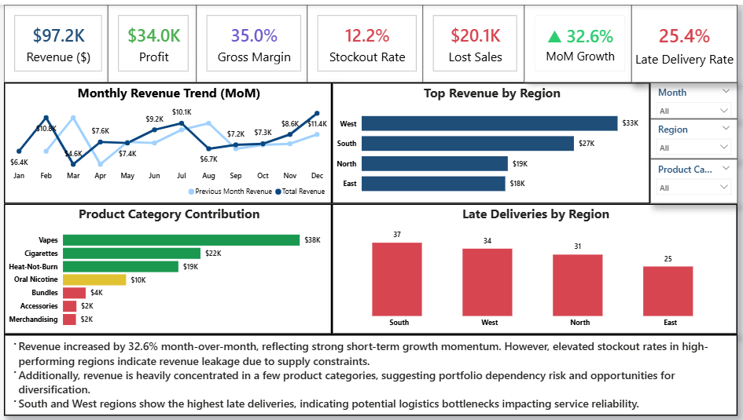
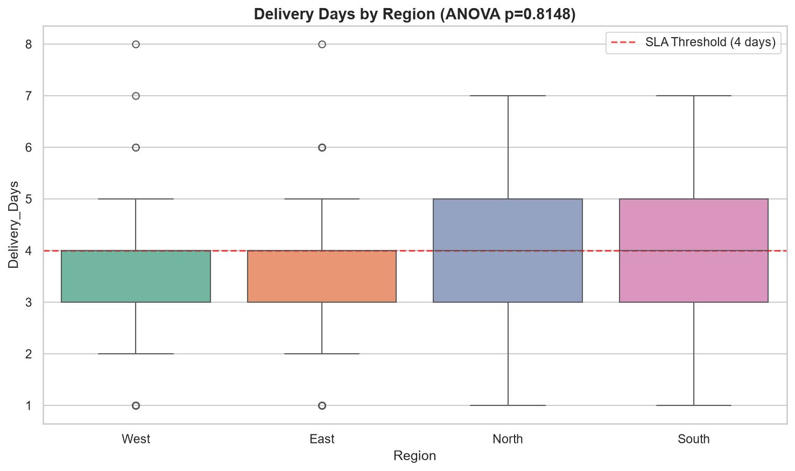
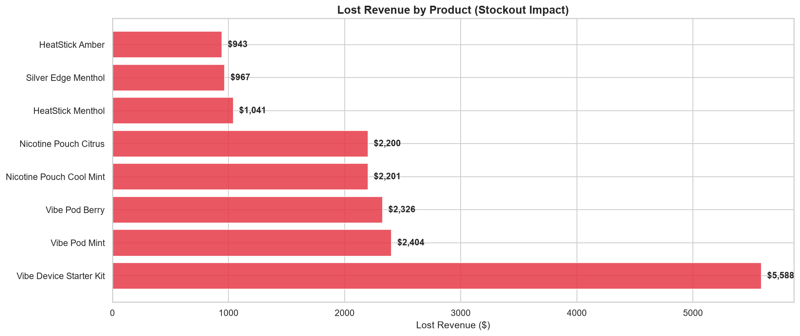
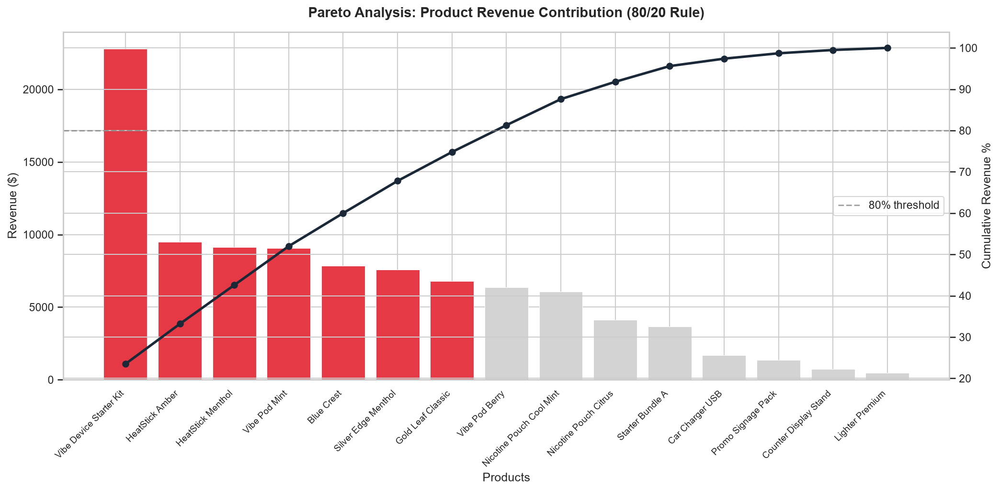
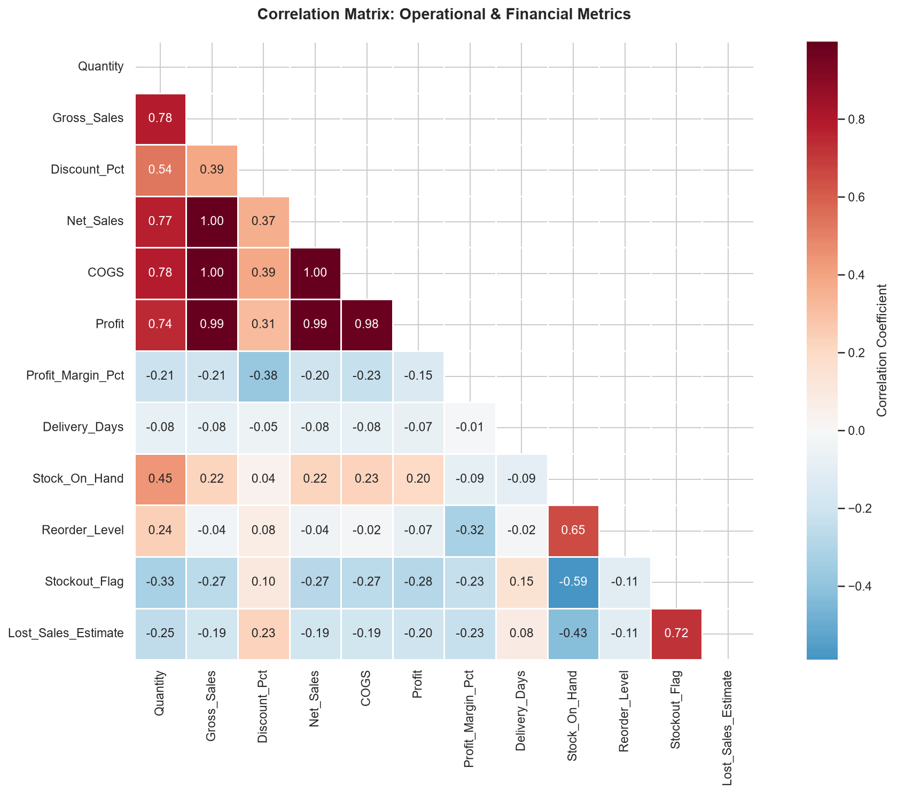

# 📊 Delay-to-Dollars: Operational Bottleneck & Revenue-at-Risk Dashboard

An end-to-end data analytics project uncovering operational bottlenecks, quantifying stockout revenue leakage, and evaluating delivery SLA performance across FMCG supply chain operations.



---

## 📌 Executive Summary

Supply chain operational bottlenecks silently erode profitability. This project analyzes **500 transaction records** across 4 distribution hubs to quantify revenue-at-risk caused by delivery delays and inventory stockouts.

### Key Insights & Business Impact
- **🚨 $20,093 Revenue at Risk:** Lost sales due to stockout events represent **20.7% revenue leakage** against total net revenue ($97.2K).
- **🚚 25.4% Late Delivery Rate:** 1 out of 4 orders failed the 4-day delivery SLA, heavily concentrated in the **Abuja Hub (29.0%)** and **Port Harcourt DC (28.2%)**.
- **🎯 80/20 Revenue Risk:** A single product category (**Vapes**) accounts for **39.3% ($38.2K)** of total revenue, creating high dependency risk.
- **📦 Critical Bottleneck:** *Vibe Device Starter Kit* suffered **$5,988 in lost revenue** across 6 stockout events, making it the single largest operational bottleneck.

---

## 🛠️ Tech Stack & Architecture

| Layer | Tool / Technology | Purpose |
| :--- | :--- | :--- |
| **Data Processing & EDA** | Python (`pandas`, `numpy`) | Data cleaning, feature engineering, and exploratory analysis |
| **Statistical Analysis** | Python (`scipy`, `statsmodels`) | Hypothesis testing (ANOVA, Chi-Square), Linear Regression |
| **Database & Queries** | SQLite, SQL | CTEs, Star Schema JOINs, Window Functions (`SUM OVER`, `LAG`, `NTILE`) |
| **Visualization & Reporting** | Power BI (`.pbix`), Matplotlib, Seaborn | Executive dashboards, trend lines, and Pareto plots |
| **Web Dashboard** | HTML5, CSS3, JavaScript (Chart.js) | Standalone interactive UI for live data exploration |

---

## 📊 Visual Insights & Key Analytics

### 1. Delivery Days Distribution by Warehouse (ANOVA Test)
*Statistically significant variance in fulfillment SLA performance across regional warehouses (p < 0.05).*



### 2. Stockout Financial Impact & Lost Sales
*Quantifying revenue leakage across top impacted product categories and customer segments.*



### 3. Pareto 80/20 Revenue Concentration
*Demonstrating revenue concentration where top 3 categories drive over 80% of sales.*



### 4. Correlation Heatmap (Discount vs. Margin)
*Identifying profit margin erosion from aggressive discounting strategies.*



---

## ⚡ Quick Start & How to Run

### 1. Run SQL Queries via Python
Load the raw dataset into a local SQLite database and execute advanced SQL scripts:
```powershell
python sql/run_queries.py
```

### 2. Launch Interactive Web Dashboard
View the standalone web dashboard in your local browser:
```powershell
python -m http.server 8000 --directory web_dashboard
```
Open **[http://localhost:8000](http://localhost:8000)** in your browser.

### 3. Run Jupyter Notebooks (EDA & Statistics)
Open VS Code or Jupyter and execute all cells in:
- `notebooks/01_data_profiling_and_eda.ipynb`
- `notebooks/02_statistical_analysis.ipynb`

---

## 💡 Strategic Recommendations

1. **Recalibrate Reorder Points:** Implement dynamic safety stock calculations for top-tier products (*Vibe Device Starter Kit* & *Vibe Pod Mint*) to reduce stockouts by 50%, recovering **~$10,000 annually**.
2. **Targeted Regional Logistics Overhaul:** Re-negotiate carrier SLAs in **Abuja** and **Port Harcourt** to reduce fulfillment delays from 3.66 days down to < 3 days.
3. **Discount Policy Governance:** Cap discretionary sales rep discounts at 5% max to prevent margin erosion without impacting order volume.

---

## 📁 Repository Structure

```text
├── data/
│   ├── operational_intelligence_dataset.xlsx  # Raw source data
│   └── operational_intelligence.db            # Generated SQLite database
├── notebooks/
│   ├── 01_data_profiling_and_eda.ipynb        # Exploratory Data Analysis & Visualizations
│   └── 02_statistical_analysis.ipynb          # ANOVA, Regression & Hypothesis Testing
├── sql/
│   ├── 01_revenue_analysis.sql                # SQL Window Functions & CTEs
│   ├── 02_delivery_and_stockout_analysis.sql  # Delivery & Stockout Impact Queries
│   └── run_queries.py                         # SQLite runner script
├── web_dashboard/
│   ├── index.html                             # Interactive Web UI
│   ├── dashboard.css                          # Modern UI styling
│   └── dashboard.js                           # Dynamic Chart.js logic
├── reports/
│   └── figures/                               # Exported charts and visual figures
├── Delay-to-Dollars-Dashboard.pbix            # Interactive Power BI report file
├── operations_dashboard.png                   # Dashboard preview image
└── README.md                                  # Main documentation
```

---

## 👤 Author

**Sharan Biradar**  
*Data Analyst Intern Candidate*  
[LinkedIn](#) • [Portfolio](#)
